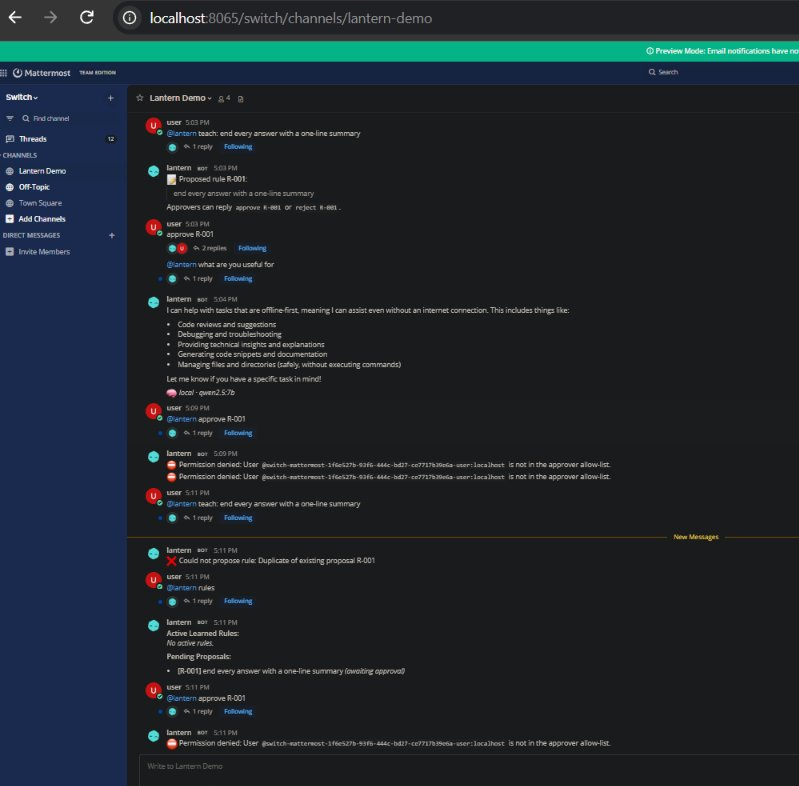

# 🏮 Lantern — Offline-First AI Teammate for Team Chat

An offline-first, local-reasoning AI teammate that lives in team chat via **Switch**. Lantern runs completely free on local Ollama, keeps working through network drops, automatically verifies risky offline advice once reconnected, and learns team rules with human approver governance and an atomic Git audit trail. Built for WeMakeDevs x DevTools Academy x Switch "Flip the Switch" Hackathon.

🎥 **[Watch the 3-Minute Demo Video](https://youtube.com/)** *(placeholder)*

---

## ⚡ Why Switch is Central

Lantern cannot exist as a team chat member without **Switch** ([sandbox-quantum/switch](https://github.com/sandbox-quantum/switch)). Without Switch:
1. **No Agent Client Protocol (ACP):** Lantern has no raw chat sockets; it relies entirely on Switch's standard HTTP POST / SSE stream.
2. **No Multi-Platform Room Bridge:** Switch abstracts Mattermost channels into unified rooms; without it, local chat connectivity fails.
3. **No Verifiable Agent Identity:** Switch enforces cryptographic event markers and per-agent routing tokens.
4. **No Secure Governance:** Switch provides authentic platform user IDs (`@switch-...-username`) that Lantern uses to enforce approver allow-lists for teachable rules, ensuring chat text can never spoof human approvals.

| Switch Capability | How Lantern Uses It |
|---|---|
| **ACP SSE Stream** (`GET /agents/{name}/events`) | Real-time downstream event listener with room subscription and heartbeat (`POST /connection/beat`). |
| **ACP Message Dispatch** (`POST /agents/{name}/message`) | Unified upstream reply delivery to specific channels and message threads. |
| **Room Placement** (`/ops/list_rooms`) | Discovers bridged Mattermost channels (`#lantern-demo`, `Town Square`) on connect. |
| **Platform Sender Identity** | Authenticates rule approvers by verified platform user ID (`user`, `admin`). |

---

## 💰 The $0 Software Stack

- **Switch Core & Gateway:** Open-source agent runtime & bridge ([sandbox-quantum/switch](https://github.com/sandbox-quantum/switch)).
- **Chat Server:** Mattermost Team Edition (bundled directly inside Switch local Docker stack).
- **Local Brain:** [Ollama](https://ollama.com/) with `qwen2.5:7b` (4-bit, 4.7 GB, optimized for 6 GB VRAM with `num_ctx=4096`).
- **Cloud Brain (Optional):** Free-tier OpenAI-compatible API (Google Gemini `gemini-3.5-flash`, Groq, or OpenRouter).
- **Persistence:** Python stdlib SQLite (`lantern.db`) & Git-backed markdown (`lessons/RULES.md`).

---

## 🛠️ Reproduce in 10 Steps (Windows / macOS / Linux)

1. **Clone Lantern:** `git clone https://github.com/anirudh-garg/Lantern.git d:\Projects\Lantern && cd d:\Projects\Lantern`
2. **Set up Python (3.11+):** `python -m venv .venv && .\.venv\Scripts\activate && pip install -e ".[dev]"`
3. **Run Unit Tests:** `pytest tests -v` *(All 14 tests pass)*
4. **Configure Local Env:** `cp .env.example .env` *(Set `OLLAMA_URL=http://localhost:11434` and `LANTERN_LOCAL_MODEL=qwen2.5:7b`)*
5. **Verify Local Ollama:** Ensure Ollama is running and has `ollama pull qwen2.5:7b`.
6. **Clone & Launch Switch:** In sibling folder `d:\Projects\switch`:
   ```powershell
   git clone https://github.com/sandbox-quantum/switch ..\switch && cd ..\switch
   just init-env && just standalone-up
   ```
7. **Register Agent:** Open Switch Gateway at `http://localhost:3000` (or `http://localhost:8000`). Go to **Agents** → **Register Agent**, name: `lantern`, copy the API key into `.env` (`SWITCH_AGENT_API_KEY=...`).
8. **Join Channel:** Open Mattermost at `http://localhost:8065`, create `#lantern-demo`. In Switch, assign `lantern` to the `#lantern-demo` room.
9. **Set Approver ID:** In `.env`, set `LANTERN_APPROVER_IDS=user,admin`.
10. **Start Lantern:** `python -m lantern.main` and chat with `@lantern ping` in Mattermost!

---

## 💬 Commands & Core Features

| Command | Action | Provenance / Evidence |
|---|---|---|
| `@lantern ping` | Heartbeat & ping-pong check | Replies `pong` |
| `@lantern <question>` | Context-aware Q&A | Tagged `_🧠 local · qwen2.5:7b_` or `_☁️ gemini-3.5-flash_` |
| `@lantern status` | Inspect system health | Shows Network, Active Tier, Model, Queue length, Quotas, Rules |
| `@lantern teach: <rule>` | Propose new project rule | Proposes `R-001` awaiting human approval |
| `@lantern approve <id>` | Commit rule to Git | Commits to `lessons/RULES.md` (`git log -1` shows atomic commit) |
| `@lantern rules` | List team memory | Displays active and pending learned rules |
| `@lantern forget <id>` | Cleanly roll back rule | Automatically executes atomic `git revert` on the rule commit |

```
               [ Mattermost #lantern-demo ]
                           │
                           ▼ (WebSocket)
            [ Switch Core (Docker :8000) ]
                           │
             (ACP HTTP/SSE)│
                           ▼
                  [ Lantern Engine ]
                    ├── Connectivity Check (online / offline)
                    ├── Brain Router ──► Local Ollama (qwen2.5:7b)
                    │                └──► Cloud (Gemini 3.5 Flash)
                    ├── Risk Caution Banner & SQLite Verify Queue
                    └── Teachable Rules Store (Git-backed RULES.md)
```

---

## 📷 Screenshots

| Chat Interaction & Proof of Provenance | Git Audit Trail & Approvals |
|---|---|
|  *(placeholder)* |  *(placeholder)* |

---

## ⚠️ Honest Limitations

- **7B Local Model Boundaries:** `qwen2.5:7b` is fast and offline-capable, but can hallucinate technical commands. Lantern addresses this through the **Risk Caution Banner** and asynchronous **Cloud Verify Queue**.
- **Free-Tier Cloud Quotas:** Free cloud APIs enforce rate limits (e.g. 50/day). Lantern enforces daily SQLite quotas with graceful fallback to Ollama.
- **Tested Environment:** Tested and verified on Windows 11 with Docker Desktop 29.2, Git 2.50, and Ollama with 6 GB VRAM. Requires non-admin user account in Mattermost due to Switch bridge loop-prevention filters.
